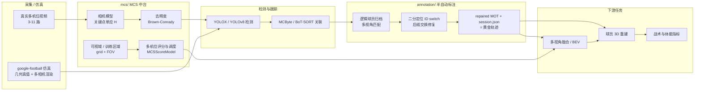

# football — 多机位足球视频分析工具链

把一场比赛的 3–11 路机位视频，变成**带身份的球员 3D 轨迹**，需要一条完整的工具链：
相机标定 → 多机位调度 → 检测/跟踪 → 人工校正 → 多视角融合 → 战术可视化。

本仓库是结题工作中**可复用软件部分**的汇总，包含两个系统：

| 目录 | 系统 | 一句话说明 |
|---|---|---|
| [`mcs/`](mcs/README.md) | **MCS 中台程序**（Multi-Camera System） | 相机模型 / 标定 / 多机位评分与调度 / 球场配置 / 标注与导出工具的统一平台 |
| [`annotation/`](annotation/README.md) | **半自动多视角匹配标注工具** | 在预标注轨迹上做"逻辑球员归档 + 二分定位 ID switch"，产出多机位黄金轨迹 |
| `football_analysis-main/` | 单机位分析基线 | 工程起点：单镜头检测、BoT-SORT 跟踪、单应映射到球场俯视图 |

配套的**仿真足球环境**（Google Research Football 的多相机合成数据平台）在另一个仓库：
[`photon-xxx/google-football`](https://github.com/photon-xxx/google-football)。

---

## 1. 两个系统为什么合在一起

它们在同一条流水线上首尾相接，中间的数据格式是互相约定的：



关键点：**中台负责"几何"，标注工具负责"身份"**。
中台给出每个像素在球场上的位置和每个机位对某块草皮的可见质量；
跟踪器给出稠密但会串号的轨迹；标注工具用最少的点击把这些轨迹绑到"人"身上。
三者产物汇合后，多视角融合才有可靠的输入。

---

## 2. 目录结构

```
football/
├── mcs/                          # MCS 中台程序
│   ├── MCS.py                    #   MCSDetector / MCSScoreModel / MultiCameraScheduler / MCS
│   ├── camera.py                 #   Camera、CameraFOVCalculator、VideoManager、ColorDetector、TrainArea
│   ├── soccer.py                 #   7 种球场配置（标准 / 半场 / 吴川 / 清远 / CUMTB）
│   ├── de_distortion.py          #   Brown-Conrady 畸变模型 + 可微标定（线约束）
│   ├── distort.py                #   畸变正/反算（迭代反解）
│   ├── area.py                   #   关键点 / 标记线 / 射门区交互标注器
│   ├── grid_system.py            #   球场栅格化（可视域统计）
│   ├── pitchtrack.py             #   球场坐标系下的卡尔曼跟踪
│   ├── ocr.py                    #   球衣号码识别（DashScope，需自备 API Key）
│   ├── local_calibrator.py       #   本地标注 + 远端 GPU 计算的标定编排
│   ├── server_runner.py          #   服务端单机位跟踪任务入口
│   ├── auto_run.py               #   一键标定流程
│   ├── undistort_video.py        #   整段视频去畸变
│   ├── tools/                    #   frame / transform / bbox / IoU / distance / pitch 绘制
│   │   └── annotation/           #   球员逐帧标注、球场状态可视化、kloppy 导出
│   ├── docs/images/              #   标注界面截图
│   └── README.md                 #   中台使用文档（标注顺序、球场配置、坐标系约定）
│
├── annotation/                   # 半自动多视角匹配标注工具
│   ├── code/
│   │   ├── track_repair_ui.py            # 基类：MOT 读写、随机访问解码、二分状态机、渲染
│   │   ├── run_track_repair_ui.py        # 单视角入口
│   │   ├── run_track_repair_ui_players.py# 逻辑球员归档
│   │   ├── run_track_repair_ui_session.py# 三视角共享 session
│   │   ├── run_track_repair_ui_multiview.py  # 多视角入口（主推）
│   │   └── run_track_repair_ui_focus.py  # 关注轨迹高亮
│   ├── docs/                     #   状态机说明与各入口指引
│   └── README.md
│
└── football_analysis-main/       # 单机位分析基线（工程起点）
    ├── main.py
    ├── Module/common/            #   team_assigner / trackers(bot_sort) / view_transformer / utils
    ├── Module/plugin/            #   ball / player_ball_assigner / speed_and_distance_estimator
    ├── Module/visualizer/        #   2D/3D 可视化、球场标注、轨迹绘制
    └── Storage/field_configs/    #   球场关键点定义
```

---

## 3. 快速开始

### 3.1 环境

```bash
pip install -r mcs/requirements.txt
pip install opencv-python numpy          # 标注工具只需要这两个
```

Python 3.10+。中台的跟踪入口还需要额外的 **BoT-SORT**（含 YOLOX 与 FastReID）：
把它放到 `mcs/BoT-SORT/`，或修改 `mcs/config.py` 里的 `BOTSORT_ROOT`。
仓库不包含任何模型权重与视频数据（体积大且涉及场地版权）。

### 3.2 MCS 中台：标定一个机位

```bash
cd mcs
# 交互式：关键点 → 横向线 → 纵向线 → 训练区域
python auto_run.py --id 1 --pitch cumtb
```

标定产物落在 `local_calibration/camera<id>/`：

| 文件 | 内容 |
|---|---|
| `camera_info.json` | 单应矩阵 `homography_matrix`、相机内外参、FOV |
| `distortion_params.json` | 畸变系数 `k1,k2,k3,p1,p2` 与标定元信息 |
| `keypoints.json` / `manual_horizontal.json` / `manual_vertical.json` | 三类人工标注原文 |
| `train_area.json` | 有效检测区域 |

> 坐标系约定（与 `soccer.py` 一致）：原点在左下角，`x` 沿场地长边（进攻方向），`y` 沿短边，单位 cm。

### 3.3 MCS 中台：多机位评分

```python
from MCS import MCS, MCSDetector, MCSScoreModel, MultiCameraScheduler
from soccer import CUMTBPitchConfiguration

config = CUMTBPitchConfiguration()
# 用各个机位的连拍帧做可视域统计与多机位得分
```

### 3.4 半自动多视角标注

```bash
cd annotation
python code/run_track_repair_ui_multiview.py --view view1
```

在自己的数据上运行时：

```bash
set MVANNOT_ROOT=D:\datasets\cumtb     # 或 $env:MVANNOT_ROOT="D:\datasets\cumtb"
python code/run_track_repair_ui.py \
    --video  D:\datasets\cumtb\view1.mp4 \
    --tracks D:\datasets\cumtb\view1_mot.txt \
    --output D:\datasets\cumtb\view1_repaired.txt
```

完整按键、二分状态机、数据格式见 [`annotation/README.md`](annotation/README.md)。

---

## 4. MCS 中台的能力清单

| 能力 | 模块 | 要点 |
|---|---|---|
| 相机模型 | `camera.py::Camera` | 单应 `pixel↔pitch`、畸变正反算、视场覆盖、连拍取帧 |
| 畸变标定 | `de_distortion.py` | Brown-Conrady 5 参数；用画面中的横/纵平行线做约束，LM 迭代求解 |
| 保定向校验 | `check_valid.py` | 像素→球场→像素往返误差 + Jacobian 行列式符号，过滤病态点 |
| 可视域量化 | `grid_system.py::PitchGridSystem` | 球场栅格化，统计每格被多少机位看到 |
| 多机位评分 | `MCS.py::MCSScoreModel` | 距离分（Sigmoid）、畸变分（按径向位置惩罚）、检测置信度分加权 |
| 多机位调度 | `MCS.py::MultiCameraScheduler` | 按目标位置挑选"当前最优机位"，减少无效推理 |
| 球场配置 | `soccer.py` | 7 个 dataclass：标准/半场 × 吴川/清远 + CUMTB，32 个关键点、边表 1-based |
| 标注工具 | `area.py`、`tools/annotation/` | 关键点、标线、训练区、球员足/头逐帧标注（可断点续标） |
| 俯视图渲染 | `tools/annotation/pitch_annotation_tool.py` | 球场绘制、点/路径/关键点、Voronoi 控制区 |
| 数据导出 | `tools/annotation/kloppy_exporter.py` | 导出 Kloppy `TrackingDataset` 与 unravelsports 兼容 parquet |
| 号码识别 | `ocr.py` | 球衣号码 OCR + 队伍聚类（DashScope 多模态接口） |

---

## 5. 与仿真平台的分工

`google-football` 提供**几何真值**：机位内参外参、球员 3D 位置、球 3D 位置、遮挡标签，
都是引擎内部直接导出的，不存在标定误差与标注歧义。
本仓库的标注工具主要服务**真实视频**，那里只有像素和人工判断。

两者的衔接点是同一套数据结构：

- 相机参数：仿真导出 `camera_info.json`，与真实标定同构 → 中台的评分/调度可以对仿真场景直接跑；
- 轨迹：都用 MOTChallenge 文本 → 标注工具可以直接打开仿真轨迹做检查；
- 球员身份：都用"逻辑球员 + 每机位轨迹列表"的 session JSON。

---

## 6. 实验与答辩材料

本仓库只放软件。实验记录、指标、可视化与结论见结题材料（独立文档），
其中与本仓库直接相关的部分：

- 多机位相机布置与可视域：`mcs/` 的栅格统计 + FOV 计算；
- 轨迹修复对多视角匹配的收益：`annotation/` 在 CumTB 三机位上的实际修复量；
- 单机位基线：`football_analysis-main/` 的球场俯视图与速度/距离估计。

---

## 7. 说明

- 仓库**不包含**数据集、视频、预训练权重（`*.pt`/`*.pth`/`*.engine`）、以及 `store/`、`output/` 下的实验产物。
- 球衣号码 OCR 需要自备 DashScope API Key，通过环境变量 `DASHSCOPE_API_KEY` 注入，代码内不再保存任何密钥。
- 远端标定编排（`local_calibrator.py` / `auto_run.py`）通过环境变量注入主机与私钥路径，见 `auto_run.py` 顶部注释。
- `football_analysis-main/` 是早期单机位实现，保留作为对照基线，接口未与 `mcs/` 统一。
