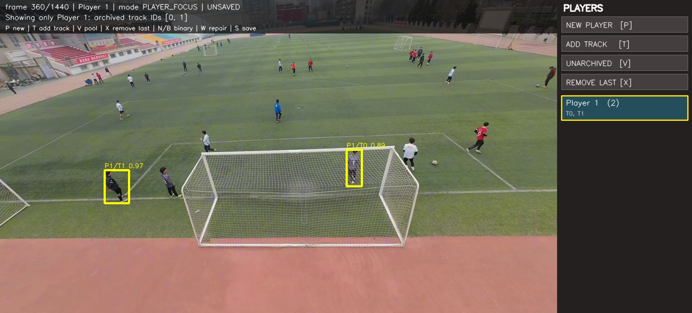

# 半自动多视角匹配标注工具（MV-Match Annotator）

用**预标注轨迹 + 人机协同**代替"从零手画框"，把多机位足球视频里的球员身份
（逻辑球员）与每条轨迹对应起来，并顺手修掉跟踪器最常见的 ID switch。

工具是 OpenCV 单窗口交互程序，无 Web 依赖，可在 Windows/Linux 上直接双击运行。



---

## 1. 它解决什么问题

多机位数据的标注成本集中在两件事上：

1. **逐帧画框**：3 个机位 × 20 人 × 每分钟 25 帧，纯手工不可行。
2. **跨视角身份一致性**：同一个球员在不同机位下是不同 track ID，下游的多视角融合、
   3D 重建、战术分析都要求"view1 的 T10"和"view2 的 T17"能对上同一个人。

本工具的做法是：**先用现成跟踪器（MCByte / YOLOX-MOT / BoT-SORT）跑出稠密轨迹，
人只做"判断 + 点击"**——

- 判断：这条轨迹属于哪个球员（一次点击归档整条轨迹，而不是逐帧画框）；
- 判断：这条轨迹在哪一帧开始串号（二分定位，而不是拖着时间轴找）；
- 点击：串号后该跟谁（一次点击完成后缀 ID 交换）。

三条轨迹级操作把标注粒度从"帧 × 框"降到"轨迹 × 决策"，这是"半自动"的关键：
机器给稠密几何，人给稀疏语义。

---

## 2. 三个递进的能力

| 入口 | 能力 | 适用场景 |
|---|---|---|
| `code/run_track_repair_ui.py` | 单视角轨迹修复：选中轨迹 → 二分找首个错误帧 → 后缀交换 | 单机位补标、修 ID switch |
| `code/run_track_repair_ui_players.py` | 逻辑球员管理：把整条 tracker ID 归档给某个球员 | 单机位球员级标注 |
| `code/run_track_repair_ui_multiview.py` | **三视角共享球员 Session**：切换机位为同一球员继续归档 | 多视角匹配（主推入口） |
| `code/run_track_repair_ui_focus.py` | 关注轨迹高亮，其余 bbox 降到 38% 灰 | 密集场景检查 |

### 2.1 二分定位 + 后缀交换（修复 ID switch）

传统做法是逐帧前后翻找"从哪一帧开始变错"。工具把它变成一个**二分搜索**：

```
选中关注球员的 bbox
  → N : 跳到该轨迹末帧
      ├─ 末帧正确 → N 接受，换下一条轨迹
      └─ 末帧错误 → B 收缩区间到中点
            ├─ 中点正确 → N
            └─ 中点错误 → B ...
  收敛到首个错误帧后按 W，点击"真正属于该球员"的 bbox
  → 从该帧到结尾交换两个 track ID
```

对一条 `N` 帧的轨迹，人工判断次数从 `O(N)` 降到 `O(log N)`：一条 1500 帧的轨迹
只需约 11 次判断定位错误起点。

### 2.2 三视角共享逻辑球员（多视角匹配）

三个机位各自维护 **独立的 track ID 命名空间**（`view1/T10` 与 `view2/T10` 可以是
两个不同的人），但**逻辑球员对象全局共享**：

```json
{
  "schema_version": 2,
  "session": "cumtb",
  "views": ["view1", "view2", "view3"],
  "players": [
    {"player_id": 1, "name": "Player 1",
     "tracks_by_view": {"view1": [0], "view2": [17], "view3": []}}
  ]
}
```

这就是"多视角匹配"的产物：一个球员 → 每个机位下一组轨迹。
下游可据此把三路观测按球员聚合，做三角化 / BEV 融合 / 重识别评测。

界面顶部 `VIEW1/VIEW2/VIEW3`（或按 `1/2/3`）切换机位，切换时"当前球员"跟随，
右侧球员列表滚动查看；`P` 新建球员、`T` 给当前球员添加轨迹、`V` 查看未归档池、
`X` 撤回当前视角最近添加的轨迹。

---

## 3. 按键

| 操作 | 功能 |
|---|---|
| 点击 bbox | 选中轨迹；`W` 之后点击表示"正确轨迹" |
| `N` | 当前判断正确 / 跳到末帧 / 接受轨迹 |
| `B` | 当前判断错误，收缩二分区间 |
| `W` | 进入交换修复状态 |
| `A` / `D` | 前 / 后 1 帧 |
| `J` / `L` | 前 / 后 10 帧 |
| 拖动时间轴 | 任意帧跳转 |
| `R` | 取消当前选择 / 二分搜索 |
| `U` | 撤销最后一次交换 |
| `S` | 保存修复后的 MOT + `repairs.json`（+ session） |
| `Q` | 退出；有未保存修改时大写 `Q` 强制放弃 |
| `P` / `T` / `V` / `X` | 新建球员 / 添加轨迹 / 未归档池 / 移除最近轨迹 |
| `1` / `2` / `3` | 切换机位（多视角版本） |

---

## 4. 数据格式

### 输入：MOTChallenge 轨迹

```
frame,id,x,y,w,h,conf,-1,-1,-1
1,0,1460.520,778.780,121.174,186.526,0.983651,-1,-1,-1
```

由跟踪器产出（本仓库流程里是 MCByte / YOLOX-MOT 的 `mask_conditioned.txt` 或
`locked_iou.txt`）。工具**只读**它，绝不覆盖原始文件。

### 输出 1：修复后的轨迹 `<view>_<tracker>_repaired.txt`

同样的 MOT 格式，只改 `id` 列。

### 输出 2：修复审计 `<...>.repairs.json`

```json
{
  "source_tracks": ".../mask_conditioned.txt",
  "output_tracks": ".../view1_mask_conditioned_repaired.txt",
  "repair_count": 6,
  "repairs": [
    {"operation": "swap_id_suffix", "start_frame": 1417, "first_id": 2, "second_id": 81}
  ]
}
```

每一步操作都可追溯、可复现，便于把"人工修正"写进实验记录当作 GT 生成过程。

### 输出 3：多视角 session `cumtb_mask_conditioned.session.json`

见 2.2。首次启动会尝试把已有的单视角 `*.players.json` 迁移到 session 文件。

---

## 5. 运行

```bash
# 依赖：Python 3.10+，opencv-python、numpy
python code/run_track_repair_ui_multiview.py --view view1
```

预设数据路径来自研究工作站目录结构（`<root>/experiment/mcbyte-*/...`）。在自己的数据上
运行时，用环境变量或命令行覆盖：

```bash
# 方式一：指定数据集根目录（该目录下应有 experiment/ 子目录）
set MVANNOT_ROOT=D:\datasets\cumtb          # PowerShell: $env:MVANNOT_ROOT="D:\datasets\cumtb"

# 方式二：单视角入口直接给视频和轨迹
python code/run_track_repair_ui.py \
    --video  D:\datasets\cumtb\view1.mp4 \
    --tracks D:\datasets\cumtb\view1_mot.txt \
    --output D:\datasets\cumtb\view1_repaired.txt
```

其它参数：`--display-width`（默认 1440）、`--headless-check`（只打印数据元信息不弹窗）、
`--tracker {mask_conditioned,locked_iou}`。

---

## 6. 目录

```
annotation/
├── code/
│   ├── track_repair_ui.py                 # 基类：MOT 读写、随机访问解码、二分状态机、渲染
│   ├── run_track_repair_ui.py             # 单视角入口（含 gap-aware 缺帧提示）
│   ├── run_track_repair_ui_players.py     # 逻辑球员归档
│   ├── run_track_repair_ui_session.py     # 三视角共享 session
│   ├── run_track_repair_ui_multiview.py   # 多视角入口（主推）
│   ├── run_track_repair_ui_focus.py       # 关注轨迹高亮
│   ├── make_player_preview.py             # 生成侧栏预览图
│   └── test_*.py / smoke_render.py        # 无头自检（渲染 + 状态机）
├── docs/
│   ├── RUN.md                             # 修复状态机完整说明
│   ├── START_SESSION_UI.md / START_PLAYER_UI.md / START_FOCUS_UI.md
│   └── images/
└── config.yaml
```

无头自检（不需要显示器）：

```bash
python code/test_track_repair_ui.py
python code/test_session_multiview.py
```

---

## 7. 在真实数据上的使用情况

CumTB 三机位（3 视角、1080p、分钟级片段）上的实际标注结果：

- 建立 31 个逻辑球员对象，其中 20 余个在三视角中都有轨迹归属（一个球员最多 3 条轨迹/机位）；
- 修复 ID switch：view1 6 处、view2 26 处、view3 1 处，全部记录在 `repairs.json` 中；
- 修复后的轨迹直接作为多视角跟踪评测的参考轨迹（GT）使用。

## 8. 已知边界

- 后缀交换假设"两个轨迹同时存在、从错误帧起一直错到结尾"；正确球员在该帧**没有 bbox**
  时无法直接交换，需要先用 `players` 版本把零散 bbox 归档到球员。
- 一次后缀交换可能影响后续其它错误，需要继续检查末帧；`U` 可逐步撤销。
- 不保存 mask / 模型 memory，跨视角身份以 session 文件为唯一真相。
