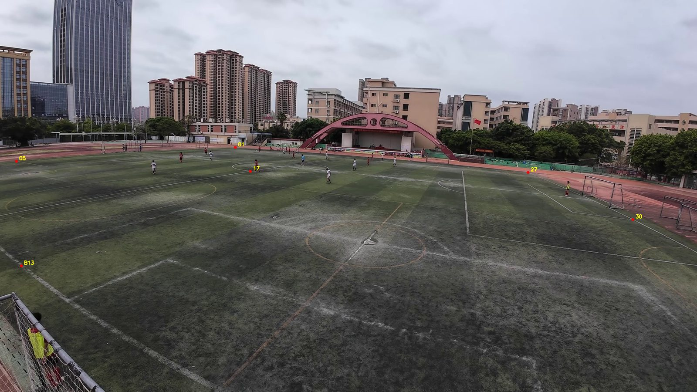
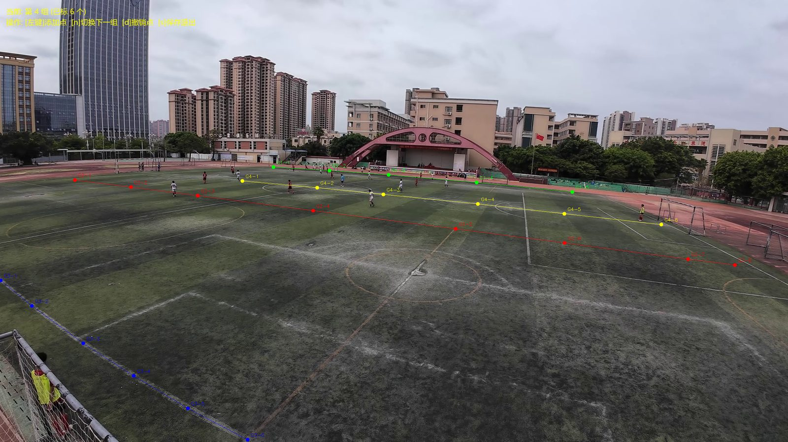
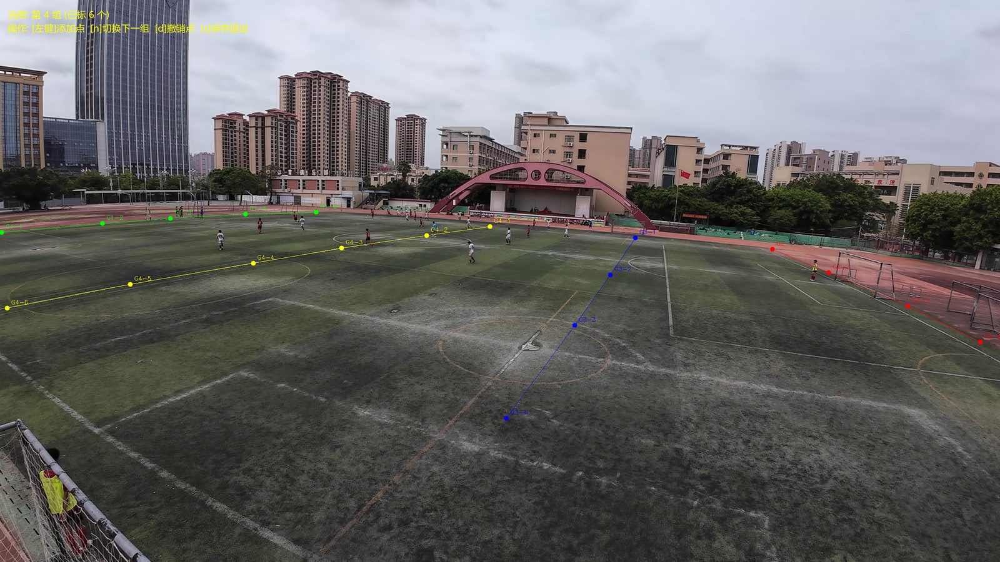

# 本地标注操作文档

标注工具位于 [`tools/annotation/`](tools/annotation/)，包含以下模块：

| 模块 | 用途 | 状态 |
|---|---|---|
| `player_annotation_tool.py` | 逐帧标注球员/球的像素坐标 | ✅ 已完成 |
| `pitch_annotation_tool.py` | 球场俯视图绘制工具函数 | ✅ 已完成 |
| `pitch_state_visualizer.py` | 根据标注数据生成球场俯视重建视频 | 🚧 开发中 |
| `kloppy_exporter.py` | 将标注数据导出为 Kloppy / Polars 格式 | 🚧 开发中 |

---

## 一、Camera 标注（单应矩阵相关）

在计算单应矩阵前，需要对每个相机视角完成以下三类标注，通常通过 `start.ipynb` 或 `camera` 对象的交互方法调用。

### 1. 关键点标注（`keypoints.json`）

用于计算像素空间到球场空间的单应矩阵。

- 尽量选取靠外侧的点（覆盖范围越大，单应精度越高），4–6 个即可
- 当前场地数据下，尽量**不选**大小禁区内的点



### 2. 横向标注（`manual_horizontal.json`）

标注画面中**平行于侧边线**的线（不必须是球场本身的线，草皮纹路也可以）。

- 按 `n` 进入下一组（分组标注多条线）



### 3. 纵向标注（`manual_vertical.json`）

标注**垂直于侧边线**的线（如草皮竖纹），用于去畸变参数估计。

- 按 `n` 进入下一组



### 4. 训练区域标注（`train_area.json`）

框定检测目标的有效区域，结合场地关键点过滤掉场外的检测框。

- 标注出训练区域边界上额外需要的点，与场地关键点共同确定区域范围

---

## 二、球员/球标注工具

**文件**：[`tools/annotation/player_annotation_tool.py`](tools/annotation/player_annotation_tool.py)

对视频按固定采样间隔逐帧标注球员足部落点（`foot`）、头部位置（`head`）和球（`ball`）。支持断点续标、回退、回滚。

### 配置

打开文件，修改顶部硬编码配置：

```python
VIDEO_PATH        = r"path/to/video.mp4"      # 视频路径
OUTPUT_PATH       = r"path/to/annotations.json"  # 输出标注文件路径
SAMPLING_INTERVAL = 15    # 采样间隔（帧），15 表示每 15 帧标注一帧
DISPLAY_SCALE     = 1.0   # 显示缩放比例（屏幕较小时可设为 0.5）
TEST_COUNT        = 0     # 测试目标数量（0 表示正常标注模式）
ROLLBACK_FROM     = -1    # 回滚起始帧（-1 表示不回滚）
```

### 运行

```bash
python tools/annotation/player_annotation_tool.py
```

首次运行时会交互式询问：
- 队伍人数（t1/t2 总人数含门将）
- 门将人数
- 比赛标识、半场编号、队伍名称、球场配置类名

### 标注顺序

每帧按以下顺序依次标注：

```
t1_gk1 [foot → head]  →  t1_gk2 ... → t1_p1 [foot → head] → ... → t2_gk1 → ... → ball
```

每个球员标注两个点：
- **foot**：球员在球场上的投影点（脚底）
- **head**：头部位置

### 按键说明

| 按键 | 操作 |
|---|---|
| 左键单击 | 标注当前目标的坐标 |
| 右键单击 / `n` | 当前目标标为 NULL（不可见/不标注） |
| `z` / Backspace | 撤销上一个标注点 |
| `b` | 回退到上一帧（并撤销该帧标注） |
| `Space` / `Enter` | 当前帧标注完成，保存并进入下一帧 |
| `s` | 手动保存到磁盘 |
| `q` | 保存并退出 |

### 输出格式（`annotations.json`）

```json
{
  "meta": {
    "video": "...", "sampling_interval": 15, "fps": 25.0,
    "t1_count": 11, "t2_count": 11, "t1_gk_count": 1, "t2_gk_count": 1,
    "game_id": "match_001", "period_id": 1,
    "team1_name": "Team1", "team2_name": "Team2",
    "pitch_config": "WuChuanConfiguration"
  },
  "frames": {
    "0": {
      "t1": {
        "goalkeepers": { "gk1": { "foot": {"x": 320, "y": 540}, "head": {"x": 318, "y": 490} } },
        "players":     { "p1":  { "foot": {"x": 210, "y": 600}, "head": null } }
      },
      "t2": { ... },
      "ball": { "x": 640, "y": 360 }
    }
  }
}
```

---

## 三、球场状态可视化 🚧 开发中

**文件**：[`tools/annotation/pitch_state_visualizer.py`](tools/annotation/pitch_state_visualizer.py)

读取标注数据和相机单应矩阵，将像素坐标映射到球场坐标，在球场俯视图上绘制所有追踪目标，并输出平滑插值视频。

### 配置

修改文件顶部：

```python
ANNOTATIONS_PATH  = r"path/to/annotations.json"
CAMERA_INFO_PATH  = r"path/to/camera_info.json"   # 包含 homography_matrix
OUTPUT_VIDEO_PATH = r"path/to/output.mp4"

PITCH_CONFIG = QingYuanConfiguration()  # 替换为对应场地配置类
PITCH_SCALE  = 0.2
OUTPUT_FPS   = 30
```

### 运行

```bash
python tools/annotation/pitch_state_visualizer.py
```

输出为 30fps 平滑视频，采样帧间做线性插值。同时会检测传球、铲球、射门事件，叠加显示在画面上。

---

## 四、Kloppy / UnravelSports 数据导出 🚧 开发中

**文件**：[`tools/annotation/kloppy_exporter.py`](tools/annotation/kloppy_exporter.py)

将 `annotations.json` + `camera_info.json` 转换为：
- Kloppy `TrackingDataset` 对象
- UnravelSports 兼容的 Polars DataFrame（`.parquet`）

坐标管道：像素坐标 → `video_pixel_to_pitch`（含去畸变）→ 归一化 [0,1] 球场坐标

### 命令行用法

```bash
python tools/annotation/kloppy_exporter.py \
    --annotations  path/to/annotations.json \
    --camera-info  path/to/camera_info.json \
    [--distortion  path/to/distortion_params.json] \
    [--output      path/to/output.parquet] \
    [--interpolate]
```

| 参数 | 说明 |
|---|---|
| `--annotations` | 标注文件路径（必填） |
| `--camera-info` | 相机信息文件路径，包含 `homography_matrix`（必填） |
| `--distortion` | 畸变参数文件路径（可选，存在时自动开启去畸变） |
| `--output` | 输出 `.parquet` 路径（默认与标注文件同目录） |
| `--interpolate` | 在采样帧之间做线性插值，补全到完整帧率 |

### Python API 用法

```python
from tools.annotation.kloppy_exporter import (
    build_normalized_keyframes,
    build_kloppy_dataset,
    to_polars_dataframe,
    compute_velocities,
)

# 加载数据
keyframes, all_keys = build_normalized_keyframes(annotations, H, pitch_length, pitch_width)

# 构建 Kloppy dataset
dataset = build_kloppy_dataset(keyframes, all_keys, meta, fps)

# 构建 Polars DataFrame（含速度/加速度）
velocities = compute_velocities(keyframes, all_keys, fps, sampling_interval)
df = to_polars_dataframe(keyframes, all_keys, velocities, meta, fps)
```

---

## 五、球场俯视图绘制工具

**文件**：[`tools/annotation/pitch_annotation_tool.py`](tools/annotation/pitch_annotation_tool.py)

提供一组绘制函数，供其他工具复用，也可独立调用。

```python
from tools.annotation.pitch_annotation_tool import (
    draw_pitch,
    draw_points_on_pitch,
    draw_paths_on_pitch,
    draw_pitch_voronoi_diagram,
    draw_pitch_with_keypoints,
)
from soccer import WuChuanConfiguration
import numpy as np

config = WuChuanConfiguration()

# 绘制空白球场
pitch = draw_pitch(config, scale=0.1)

# 在球场上标点（自动编号）
points = np.array([[1000, 3400], [2500, 5000]])
pitch = draw_points_on_pitch(config, points, pitch=pitch)

# 绘制带关键点标注的球场参考图
pitch = draw_pitch_with_keypoints(config)

# 绘制 Voronoi 控制区域
pitch = draw_pitch_voronoi_diagram(config, team1_xy, team2_xy)
```

支持的球场配置类（定义于 `soccer.py`）：

| 配置类 | 说明 |
|---|---|
| `SoccerPitchConfiguration` | 标准全场 |
| `HalfPitchConfiguration` | 标准半场 |
| `WuChuanConfiguration` | 吴川场地全场 |
| `HalfWuChuanConfiguration` | 吴川场地半场 |
| `QingYuanConfiguration` | 清远场地全场 |
| `HalfQingYuanConfiguration` | 清远场地半场 |
| `CUMTBPitchConfiguration` | CUMTB 场地 |

---

## 六、定义新的球场配置

球场配置类定义于 `soccer.py`，所有配置均为 Python `dataclass`。新建一个场地配置需要完成以下五个部分。

### 1. 基础尺寸参数

```python
from dataclasses import dataclass, field
from typing import List, Tuple

@dataclass
class MyPitchConfiguration:
    width: int = 4400         # [cm] 场地宽度（垂直于进攻方向）
    length: int = 6600        # [cm] 场地长度（进攻方向）
    penalty_box_width: int = 2400    # [cm] 大禁区宽（平行底线）
    penalty_box_length: int = 1000   # [cm] 大禁区纵深（从底线量起）
    goal_box_width: int = 1400       # [cm] 小禁区宽
    goal_box_length: int = 400       # [cm] 小禁区纵深
    centre_circle_radius: int = 550  # [cm] 中圈半径
    penalty_spot_distance: int = 700 # [cm] 点球点到底线距离
```

> **坐标系约定**：原点在左底线角点 `(0, 0)`，x 轴沿场地长度方向（进攻方向），y 轴沿宽度方向。

### 2. `vertices` 关键点列表（`@property`）

`vertices` 返回 `List[Tuple[int, int]]`，每个元素是球场坐标 `(x, y)`（单位 cm）。**列表索引从 0 开始**，但 `edges` 中引用时使用 **1 起始编号**。

标准全场配置包含 32 个基础关键点（角点、禁区角点、点球点、中线端点等），半场包含 19–22 个。可在末尾追加额外点（如草皮分界点）而不影响已有索引。

```python
@property
def vertices(self) -> List[Tuple[int, int]]:
    return [
        (0, 0),                                           # 1. 左上角
        (0, (self.width - self.penalty_box_width) / 2),  # 2. 左底线-大禁区上
        (0, (self.width - self.goal_box_width) / 2),     # 3. 左底线-小禁区上
        (0, (self.width + self.goal_box_width) / 2),     # 4. 左底线-小禁区下
        (0, (self.width + self.penalty_box_width) / 2),  # 5. 左底线-大禁区下
        (0, self.width),                                  # 6. 左下角
        # ... 参照 WuChuanConfiguration 中的完整列表 ...
        (0, self.width / 2),   # 追加：底线中点（自定义辅助点）
    ]
```

### 3. `edges` 连线定义

`edges` 是 `List[Tuple[int, int]]`，每个元素表示两关键点之间的连线，**编号从 1 开始**（对应 `vertices[i-1]`）。

```python
edges: List[Tuple[int, int]] = field(default_factory=lambda: [
    (1, 2), (2, 3), (3, 4), (4, 5), (5, 6),   # 左底线
    (3, 7), (7, 8), (8, 4),                     # 小禁区
    (2, 10), (10, 11), (11, 5),                 # 大禁区
    (1, 14), (6, 17),                           # 上下边线
    (14, 15), (15, 19), (19, 16), (16, 17),    # 中线
])
```

### 4. `labels` 标签列表

`labels` 是与 `vertices` **等长**的字符串列表，用于标注工具中显示点的编号。

- 标准关键点使用两位数字字符串，如 `"01"`, `"14"`
- 草皮分界点约定使用 `T{i}`（上边线）和 `B{i}`（下边线）前缀，绘图时会自动以更小的字体和图标呈现

```python
labels: List[str] = field(default_factory=lambda: [
    "01", "02", "03", "04", "05", "06",
    "07", "08", "09", "10", "11",
    "12", "13", "14", "15", "16", "17",
    "18",          # 自定义追加点
    "T1", "B1", "T2", "B2",  # 草皮分界点（自动小图标）
])
```

### 5. `colors` 颜色列表

`colors` 是与 `vertices` **等长**的十六进制颜色字符串，用于 `draw_pitch_with_keypoints` 可视化。

| 颜色 | 惯例用途 |
|---|---|
| `#FF1493` 粉红 | 禁区、底线区域关键点 |
| `#00BFFF` 天蓝 | 中线、中圈关键点 |
| `#FF6347` 橙红 | 全场对侧禁区关键点 |
| `#FFFFFF` 白色 | 自定义追加的辅助点 |
| `#00FF00` 绿色 | 草皮分界点 |

### 6. 注册到标定工具

在 `local_calibrator.py` 的 `PITCH_CONFIGS` 字典中添加条目，即可通过命令行参数选择：

```python
PITCH_CONFIGS = {
    # ... 已有条目 ...
    "my_pitch_full": MyPitchConfiguration,   # 新增
}
```

在 `player_annotation_tool.py` 首次运行的交互询问中，球场配置类名需与类名字符串完全匹配（如输入 `"MyPitchConfiguration"`）。

### 完整最小示例

```python
from dataclasses import dataclass, field
from typing import List, Tuple

@dataclass
class CustomHalfPitch:
    """自定义半场示例（30m × 40m）"""
    width: int = 3000
    length: int = 4000
    penalty_box_width: int = 1800
    penalty_box_length: int = 800
    goal_box_width: int = 1000
    goal_box_length: int = 300
    centre_circle_radius: int = 500
    penalty_spot_distance: int = 600

    @property
    def vertices(self) -> List[Tuple[int, int]]:
        return [
            (0, 0),                                                           # 1. 左上角
            (0, (self.width - self.penalty_box_width) / 2),                  # 2. 大禁区上
            (0, (self.width - self.goal_box_width) / 2),                     # 3. 小禁区上
            (0, (self.width + self.goal_box_width) / 2),                     # 4. 小禁区下
            (0, (self.width + self.penalty_box_width) / 2),                  # 5. 大禁区下
            (0, self.width),                                                  # 6. 左下角
            (self.goal_box_length, (self.width - self.goal_box_width) / 2),  # 7. 小禁区右上
            (self.goal_box_length, (self.width + self.goal_box_width) / 2),  # 8. 小禁区右下
            (self.penalty_spot_distance, self.width / 2),                    # 9. 点球点
            (self.penalty_box_length, (self.width - self.penalty_box_width) / 2),  # 10. 大禁区右上
            (self.penalty_box_length, (self.width + self.penalty_box_width) / 2),  # 11. 大禁区右下
            (self.length, 0),                                                 # 12. 中线上端
            (self.length, self.width / 2 - self.centre_circle_radius),       # 13. 中圈上端
            (self.length, self.width / 2 + self.centre_circle_radius),       # 14. 中圈下端
            (self.length, self.width),                                        # 15. 中线下端
            (self.length - self.centre_circle_radius, self.width / 2),       # 16. 中圈左点
            (self.length, self.width / 2),                                    # 17. 中点
            (0, self.width / 2),                                              # 18. 底线中点
        ]

    edges: List[Tuple[int, int]] = field(default_factory=lambda: [
        (1, 2), (2, 3), (3, 4), (4, 5), (5, 6),   # 左底线
        (3, 7), (7, 8), (8, 4),                     # 小禁区
        (2, 10), (10, 11), (11, 5),                 # 大禁区
        (1, 12), (6, 15),                           # 上下边线
        (12, 13), (13, 17), (17, 14), (14, 15),    # 中线
    ])

    labels: List[str] = field(default_factory=lambda: [
        "01", "02", "03", "04", "05", "06",
        "07", "08", "09", "10", "11",
        "12", "13", "14", "15", "16", "17", "18",
    ])

    colors: List[str] = field(default_factory=lambda:
        ["#FF1493"] * 11 + ["#00BFFF"] * 6 + ["#FFFFFF"] * 1
    )
```

> **验证技巧**：定义完成后运行以下代码可立即检查一致性并可视化：
>
> ```python
> cfg = CustomHalfPitch()
> assert len(cfg.vertices) == len(cfg.labels) == len(cfg.colors), "长度不一致！"
> from tools.annotation.pitch_annotation_tool import draw_pitch_with_keypoints
> import supervision as sv
> sv.plot_image(draw_pitch_with_keypoints(cfg))
> ```

---

## 七、训练场地标志物测量工具

**文件**：[`measure_marker_position.py`](measure_marker_position.py)

在已完成相机标定的视频帧上，手动标注障碍桶、标志盘等训练器材，将像素坐标转换为球场物理坐标，并自动计算组内相邻距离和组间重心/最近点距离，输出文字报告与俯视图可视化。

### 前置条件

运行本工具前，需已完成对应相机的标定（关键点标注 + 单应矩阵计算），标定文件存放于：

```
store/<CAMERA_NAME>/
├── keypoints.json
├── camera_info.json          # 包含 homography_matrix
└── distortion_params.json    # 可选，启用畸变校正时需要
```

### 1. 配置 `config.yaml`

```yaml
dir_path:    "D:/videos"               # 视频所在目录
video_name:  "training.mp4"            # 视频文件名
CAMERA_NAME: "wuchuan0430"             # 对应 store/ 下的相机目录名
config:      "HalfWuChuanConfiguration" # soccer.py 中的球场配置类名

# 组内距离测量：每项对应一组标志物
GROUP_CONFIGS: [
    {'group': 0, 'is_closed': False},  # 组1：线性排列（首尾不连）
    {'group': 1, 'is_closed': True},   # 组2：环形排列（首尾相连）
]

# 组间距离测量：每项对应一对组
PAIR_CONFIGS: [
    {'group1': 0, 'group2': 1, 'type': 'both'},    # 组1↔组2：同时算重心距离和最近点距离
    {'group1': 0, 'group2': 2, 'type': 'center'},  # 组1↔组3：仅重心距离
    {'group1': 1, 'group2': 2, 'type': 'nearest'}, # 组2↔组3：仅最近点距离
]
```

| 参数 | 说明 |
|---|---|
| `group` | 组索引，从 0 开始，对应标注时按 `n` 切换的顺序 |
| `is_closed` | `True` = 环形（最后一点连回第一点）；`False` = 线性 |
| `type` | `'center'` 重心距离 / `'nearest'` 最近点距离 / `'both'` 两者都算 |

### 2. 运行

```bash
python measure_marker_position.py
```

程序按以下五步自动执行：

```
[1/5] 初始化相机（加载标定文件）
[2/5] 创建测量对象
[3/5] 标注标志物（或从缓存加载）
[4/5] 转换坐标到球场系统
[5/5] 计算距离并生成报告
```

若 `store/manual/<CAMERA_NAME>/markers.json` 已存在，程序会询问是否复用缓存，输入 `n` 可重新标注。

### 3. 标注操作

启动后弹出视频第一帧的交互窗口：

| 操作 | 效果 |
|---|---|
| **左键单击** | 在当前组打一个标志物标记点 |
| **`n`** | 当前组完成，切换到下一组 |
| **`s`** | 保存所有已标注数据并关闭窗口 |
| **`z` / Backspace** | 撤销当前组最后一个点 |
| **`q`** | 放弃并退出 |

> 每次按 `n` 开始一个新的组，组的编号对应 `GROUP_CONFIGS` 和 `PAIR_CONFIGS` 中的 `group` 索引（从 0 开始）。

### 4. 输出文件

所有结果保存在 `store/manual/<CAMERA_NAME>/`：

| 文件 | 内容 |
|---|---|
| `markers.json` | 原始标注数据（像素坐标，分组） |
| `coordinates.json` | 转换后的像素坐标与球场坐标（单位 cm） |
| `measurement_report.txt` | 文字测量报告（组内相邻距离、平均间距、组间距离） |
| `visualization.jpg` | 球场俯视图，标注所有点及距离连线 |

报告示例：

```
======================================================================
训练场地标志物测量报告
相机: wuchuan0430   组数: 2
======================================================================

【标志物组概览】
  组 1: 5 个标志物
  组 2: 4 个标志物

【组内距离测量】
  组 1 (线性):
    点 1 → 点 2: 1.52 m
    点 2 → 点 3: 1.49 m
    ...
    平均间距: 1.51 m

【组间距离测量】
  组 1 ↔ 组 2:
    重心距离:   8.34 m
    最近点距离: 6.12 m
======================================================================
```
